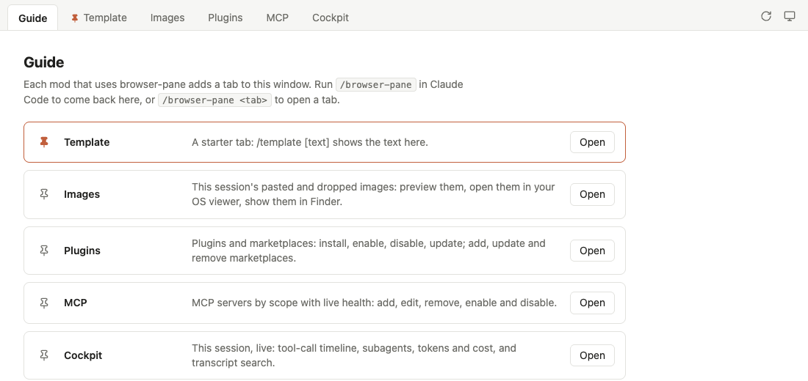

# browser-pane

Claude Code mods are no longer limited to what a terminal can draw. browser-pane gives every mod a tab in one shared browser window, and with it the whole web platform: 3D with Three.js, CAD with JSCAD, rich editors, live charts, Web Audio and MIDI, speech in and out, WebRTC, and whatever else a web page can do. The terminal stays where the conversation happens; the browser is where a mod shows and works with what the conversation is about.

A mod adds its tab through `$.browserPane`, a **Guide** tab lists them all, and browser-pane runs the one local server and window behind them, securely. The [integration guide](INTEGRATION_GUIDE.md) explains the idea and walks you through building your own.



- **One window per session.** Showing a tab while the window is open switches that window; a second one is never opened.
- **Tabs are static pages, plus an optional Node module.** The shared server serves a tab's files and sends the tab's `api/` requests to its module.
- **Locked to you.** The server listens on 127.0.0.1 only, checks the Host header, and needs a per-session token: a header for the mod, a cookie for the window.

## Install

At the prompt of a terminal session:

```
/plugin install browser-pane --marketplace sandipchitale/browser-pane
```

From a shell: `claude plugin install browser-pane --marketplace sandipchitale/browser-pane`. Answer `y` to add the marketplace, then choose a scope.

You usually don't install it yourself: a mod that uses it lists it as a dependency, and installing that mod installs browser-pane too. To try it, install one of the [examples](#examples):

```
/plugin install browser-pane-template --marketplace sandipchitale/browser-pane
```

Commands: `/browser-pane` opens the window on the Guide tab, `/browser-pane <tab>` on a tab.

It needs Node.js on your PATH and Google Chrome, which opens the window as an app window in a profile of its own. Without Chrome it opens your default browser.

## Using it from a mod

`examples/images/` is a complete mod that uses it; this section walks through the same steps.

### 1. Depend on it

In your mod's `.claude-plugin/plugin.json`:

```json
"dependencies": ["browser-pane"]
```

Claude Code then loads your mod only when browser-pane is installed, and lays browser-pane's types into your mod's `.claude-plugin/types/`, so `$.browserPane` is typed.

A bare name is looked up in **your own marketplace**, so list browser-pane there too. Then one install line installs both:

```json
{
  "name": "browser-pane",
  "source": { "source": "github", "repo": "sandipchitale/browser-pane" }
}
```

Two mods that each list it share one copy: the second is skipped, as it has the same name.

### 2. Register a tab

From `session.start`. This is cheap: nothing starts until the first `show`.

```ts
on('session.start', async ($, e, next) => {
  await $.browserPane.register({
    id: 'images',                                        // lowercase letters, digits, dashes
    title: 'Images',
    root: `${$.plugin.root}/tab`,                        // your static files: index.html at least
    server: `${$.plugin.root}/tab-server/server.mjs`,    // optional
    description: 'One line for the Guide tab.',
    pinned: true,                                        // optional: first in the Guide and the tab strip
  })
  return next(e)
})
```

### 3. Show it

```ts
const r = await $.browserPane.show({ tab: 'images', select: '2', data: { any: 'json' } })
if (!r.isOpened) {
  // r.reason says why: no $.process here (desktop app, IDE), no Node, ...
  // Show the content your own way, say in a Pane.
}
```

- `select` reaches the tab's page (see `onSelect` below).
- `data` reaches the tab's server module (`update`) before the tab shows.
- `r.how` is `'opened'` or `'reused'`.

`$.browserPane.update({ tab, data })` hands new data to the server module without bringing the window forward. The latest data is kept, and sent again if the server restarts.

### 4. The tab's page

Your `root` is served at `/tab/<id>/`. Load the client in `<head>`, so the window's theme applies before the page paints:

```html
<head>
  <script src="/bp/client.js"></script>
</head>
<script>
  browserPane.onSelect(select => { /* show it */ })      // the one it opened with first
  browserPane.onRefresh(() => { /* reload your data */ }) // the window's Refresh button; without one, the page reloads
  browserPane.api('info').then(r => r.json()).then(info => { /* ... */ })  // /tab/<id>/api/info
</script>
```

The window draws the controls every tab would otherwise repeat, as icons at the right of the tab strip: **Refresh** (the tab showing) and **Theme** (one button each for System, Light and Dark, remembered). A tab draws neither. It styles itself from `<html data-theme="light|dark">`, which the client keeps in step, and can read `browserPane.theme` or listen with `browserPane.onTheme(theme => ...)`.

Dotfiles, and links that lead outside `root`, are never served.

### 5. The tab's server module (optional)

A Node ES module whose default export makes the tab's handlers. It runs inside browser-pane's server, with full Node:

```js
export default function create({ id, root }) {
  let data = {}
  return {
    update(next) { data = next },                  // from show({ data }) and update()
    handle(req, res, sub) {                        // requests under /tab/<id>/api/; sub = 'info'
      if (sub === 'info') { res.end(JSON.stringify(data)); return true }
      return false                                 // 404
    },
  }
}
```

If the module fails to load or throws, only that tab is affected: its requests answer 404 or 500, and the Guide tab shows the error. A changed module is imported afresh the next time the tab registers.

Run commands as argv arrays (`spawn(cmd, args)`), never through a shell, and serve only files you chose, never a path the page sent.

## Examples

Each example is an independent mod: its own folder, its own `plugin.json` with `browser-pane` as a dependency, and its own `.claude-plugin/marketplace.json`. This repository's marketplace lists them too, so each installs from GitHub in one line, browser-pane with it. Each folder is also shaped like a repository of its own, the way a mod you write against browser-pane would be: its own marketplace lists the mod (`./`) and browser-pane (from GitHub).

| Mod | Tab | What it does |
|---|---|---|
| `browser-pane-template` (`examples/template`) | Template | A minimal starter: a page, a server module, and the hooks between them. Copy it to start your own mod; its `integration.md` explains the integration with browser-pane, and its `CLAUDE.md` points Claude Code there. `/template [text]`. |
| `browser-pane-images` (`examples/images`) | Images | Browse the images pasted or dropped into the prompt: `🖼  Image #N` chips above the prompt, a master/detail tab with preview, open in the OS viewer, show in Finder, copy path. `/images [n \| pane]`. |
| `browser-pane-editors` (`examples/editors`) | Plugins, MCP, Cockpit | Three tabs from one server module. Plugins: install, enable, update plugins and manage marketplaces. MCP: servers by scope with live health, add, edit, enable, disable. Cockpit: this session live (tokens and cost, subagents, search), with meters for context fill and the 5-hour, weekly and spend limits (how far through each window, when it resets). `/editors [plugins \| mcp \| cockpit]`. |

Install one, inside Claude Code:

```
/plugin install browser-pane-images --marketplace sandipchitale/browser-pane
```

### Write your own

The [integration guide](INTEGRATION_GUIDE.md) explains why browser-pane is shaped the way it is, and walks you step by step from a copy of the template to a published mod, with Claude Code.

In short: copy `examples/template` to a folder of your own, open Claude Code there, and ask it to build what you want. Its `integration.md` covers the dependency and marketplace, the `$.browserPane` calls, the page's client, the server module, the safety rules, testing and the development loop, and lists what to rename.

## How it works

```
your mod ── $.browserPane.show ──▶ browser-pane's hook ── POST /control/* (token header) ──▶ server.mjs
                                                                                              │
              Chrome app window ◀── /?t=token → cookie bp_<port> ── shell: tab strip + Guide ─┘
                                     /tab/<id>/…       your static files
                                     /tab/<id>/api/…   your server module
```

- The server starts on the first `show`, and stops a minute after the session's heartbeat stops.
- The window polls the server once a second. When a `show` comes while it polls, the open window switches tabs. This matters because Chrome hands a second launch with the same profile to the running process, which would open a new window.
- When the session ends, the window stays and says so; close it yourself.

## Developing

```
./test.sh                     # everything: the servers (node --test), then each mod's hooks (claude plugin test)
claude plugin validate .      # the manifest, the contract and the hooks module
```

`claude plugin test <dir>` runs every `*.test.ts` under `<dir>`, so each mod is tested from its own folder: `test.sh` tests browser-pane from a copy without `examples/`.

## License

MIT
